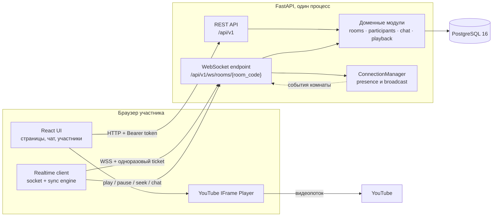
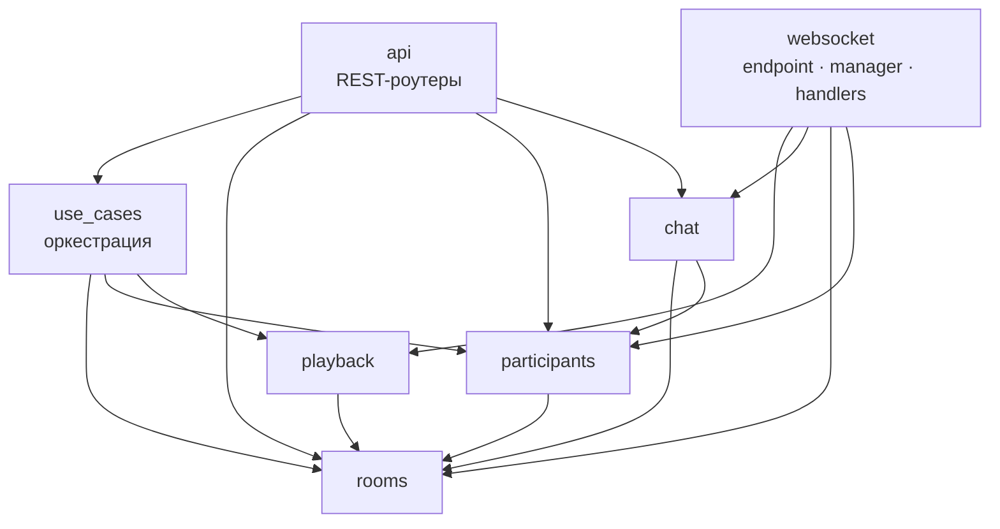
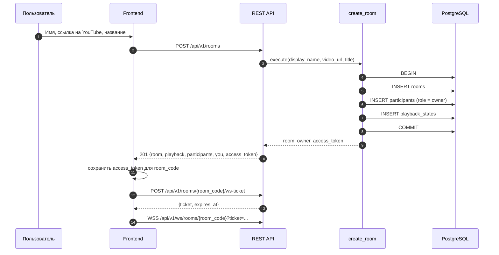
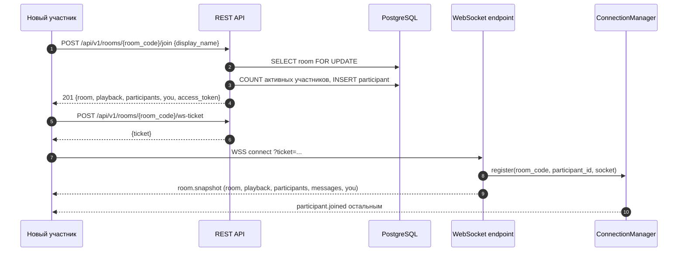
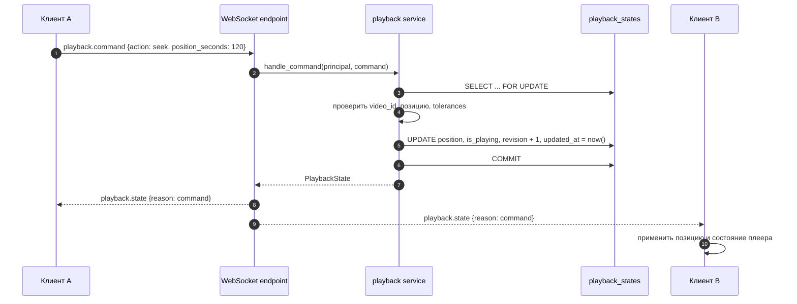

# Архитектура Watch Party

## 1. Цели и границы MVP

**Входит в MVP**

- одна комната = одно YouTube-видео = до 10 участников;
- доступ по ссылке и имени, без аккаунтов;
- синхронизация `play` / `pause` / `seek`, устойчивая к сетевым задержкам;
- выдача актуального состояния при входе и переподключении;
- чат с историей и список участников;
- права: `owner` меняет видео и закрывает комнату, все управляют воспроизведением.

**Не входит в MVP**

- регистрация, OAuth, профили, друзья;
- пароли на комнату, приватные комнаты, модерация и бан;
- очередь видео, плейлисты, поиск по YouTube;
- голосовой/видеочат, реакции, файлы;
- горизонтальное масштабирование backend и несколько инстансов;
- мобильные приложения.

## 2. Ключевые архитектурные решения

| ID | Решение | Причина |
| --- | --- | --- |
| ADR-01 | **Модульный монолит** в одном backend-процессе | Три разработчика, малый домен, WebSocket-состояние в памяти. Микросервисы дали бы сетевые границы без пользы. |
| ADR-02 | **Backend — Single Source of Truth** для состояния воспроизведения | Только сервер решает, какая позиция и какое состояние являются актуальными; клиенты не спорят между собой. |
| ADR-03 | **Событийная синхронизация вместо периодического broadcast** | Сервер отправляет состояние только при изменении, по запросу и при входе. Дрейф исправляет клиент по timestamp. Нет трафика «каждую секунду». |
| ADR-04 | **Доступ по токенам без аккаунтов**; владелец — `participants.role = 'owner'` | Не нужна отдельная сущность пользователя и отдельный токен владельца. |
| ADR-05 | **REST — жизненный цикл, WebSocket — live-операции** | Создание/вход/история/закрытие — HTTP. Playback, чат, presence, смена видео — WS. Одна мутация = один канал. |
| ADR-06 | **PostgreSQL — durable-данные, память — presence и лимиты** | Комнаты, участники, сообщения и снапшот playback переживают рестарт; подключения и rate limit — эфемерны. |
| ADR-07 | **Отдельная таблица `playback_states` (1:1 с `rooms`)** | Модуль `playback` владеет своими данными, `rooms` — жизненным циклом. Нет общих колонок у двух модулей. |
| ADR-08 | **Один процесс backend (`--workers 1`) в MVP** | Presence, grace-таймеры и rate limit живут в памяти. Путь масштабирования описан, но не реализуется. |

## 3. Контекст системы



Backend не проксирует видео: плеер каждого участника сам получает поток с YouTube. Backend
хранит метаданные (`video_id`), позицию и состояние, а также рассылает события комнаты.

## 4. Компоненты backend

| Компонент | Ответственность |
| --- | --- |
| `app/api` | Тонкие HTTP-роутеры, зависимости авторизации, преобразование ошибок в единый формат |
| `app/core` | Конфигурация, подключение к БД, UnitOfWork, часы, безопасность токенов, rate limit, логирование |
| `app/rooms` | Жизненный цикл комнаты: создание, чтение, закрытие, смена метаданных |
| `app/participants` | Вход, выход, роли, выпуск и проверка access-токенов |
| `app/chat` | Валидация и сохранение сообщений, выдача истории |
| `app/playback` | Состояние воспроизведения, обработка команд, расчёт позиции, `revision` |
| `app/use_cases` | Межмодульная оркестрация в одной транзакции (например, создание комнаты вместе с владельцем) |
| `app/websocket` | Приём соединений, ticket-авторизация, маршрутизация событий, ConnectionManager, presence, heartbeat, broadcast |

**События, инициированные REST.** Закрытие комнаты (`DELETE`) и выход (`leave`) меняют БД в
HTTP-запросе, но обязаны разослать `room.closed` / `participant.left`. Чтобы `api` не зависел от
`websocket`, в `app/core/events.py` объявлен порт `RoomEventPublisher` с примитивными аргументами
(`room_code`, `participant_id`, `closed_at`). Реализация — `app/websocket/publisher.py`, связывание —
в `main.py` через `app.state`. Направление зависимостей: `api` → `core.events` ← `websocket`.
Порт не содержит доменных DTO, поэтому `core` остаётся независимым.

Frontend разделён на слои: `pages`/`components` (UI), `api` (REST-клиент), `realtime` (протокол,
сокет, sync engine), `player` (адаптер YouTube). Контракт между `player` и `realtime` —
интерфейс `PlayerAdapter`, он описан в [WEBSOCKET.md](./WEBSOCKET.md#11-клиентская-реализация).

## 5. Модули и зависимости



Все модули могут зависеть только от `core`; стрелки «вниз» на схеме — единственные разрешённые
направления между доменными модулями. `core` не импортирует доменные модули.

**Правила, которые удерживают модульность**

1. Модуль не импортирует `models.py` или `repository.py` другого модуля. Только публичный
   `service.py` и DTO из `schemas.py`.
2. Сервис другого модуля вызывается через интерфейс (функции/класс), а не через SQL напрямую.
3. Межмодульная транзакция допустима только в `use_cases`, где сервисам передаётся один
   `UnitOfWork`/`AsyncSession`.
4. Никаких циклических импортов: если появляется цикл, операция выносится в `use_cases` либо
   перестраивается владение данными.
5. `websocket` не содержит бизнес-правил: handler валидирует событие, вызывает сервис, затем
   просит `ConnectionManager` разослать результат.
6. `api` не содержит бизнес-логики: только разбор запроса, вызов сервиса/use case, маппинг ошибок.
7. REST-операции, которым нужен broadcast (`leave`, закрытие комнаты), вызывают порт
   `RoomEventPublisher` из `core`, а не импортируют `websocket` напрямую. Реализация порта живёт в
   `websocket`, поэтому зависимость направлена в сторону `core`.

Проверка правил — на code review. При желании команда может добавить `import-linter` в CI, но это
не требуется для MVP.

## 6. Потоки основных операций

### 6.1 Создание комнаты



### 6.2 Вход участника и первичная синхронизация



`room.snapshot` — единственное место, где клиент получает полный срез комнаты. Позиция в
снапшоте передаётся как «последняя известная позиция + момент её фиксации», актуальную позицию
клиент вычисляет сам (раздел 7).

### 6.3 Play / Pause / Seek



Команда отклоняется (`error`), если видео не задано, позиция вне диапазона `0..86400`, превышен
rate limit или для `play`/`pause` позиция клиента отличается от серверной больше чем на
`PLAYBACK_POSITION_TOLERANCE_SECONDS = 3`. Последнее защищает от клиента с устаревшим состоянием.
`seek` принимает любую валидную позицию.

### 6.4 Переподключение

1. Клиент замечает разрыв и показывает баннер «Переподключение».
2. Ждёт по экспоненте: 1 → 2 → 4 → 8 → 15 с (дальше 15 с + jitter).
3. На каждую попытку получает новый `ws-ticket` по HTTP (старый уже использован/истёк).
4. После успешного connect получает `room.snapshot` и полностью применяет его.
5. Если сервер ответил `4409` (комната закрыта) или `4401`/`4403`, клиент прекращает попытки и
   показывает соответствующее состояние.

Сервер не хранит сессию WebSocket: авторизация происходит на handshake, состояние комнаты
переживает разрыв. Presence при разрыве не удаляется сразу — действует grace-период 15 секунд
(см. [WEBSOCKET.md](./WEBSOCKET.md#8-presence-и-отключение-участников)).

### 6.5 Чат

`chat.send` → проверка длины и rate limit → сохранение в `messages` → `chat.message` всем
участникам комнаты, включая отправителя. Отправитель сопоставляет `client_message_id` и заменяет
оптимистичное сообщение серверным. История старше 50 сообщений подгружается через
`GET /rooms/{room_code}/messages`.

### 6.6 Смена видео и закрытие комнаты

- **Смена видео:** `video.change` (только `owner`) → валидация YouTube-ссылки → `video_id`
  обновляется, `is_playing = false`, `position_seconds = 0`, `revision + 1` → broadcast
  `playback.state` с `reason = "video_change"`. Клиенты перезагружают плеер в паузе.
- **Закрытие:** `DELETE /api/v1/rooms/{room_code}` (только `owner`) → `status = closed`,
  `closed_at = now()` → через порт `RoomEventPublisher` рассылается `room.closed` → все сокеты
  закрываются кодом `4409`. Повторный `DELETE` идемпотентен и возвращает `204`; broadcast
  выполняется только при фактическом переходе в `closed`.

## 7. Синхронизация воспроизведения

Состояние хранится как «якорь», а не как поток обновлений:

```text
current_position(server_time) =
    is_playing ? position_seconds + (server_time − updated_at) : position_seconds
```

- `position_seconds` — позиция в момент `updated_at`;
- `updated_at` — серверное время фиксации состояния;
- `revision` — монотонный счётчик изменений комнаты;
- каждый `playback.state` содержит `server_time` отправки.

Клиент считает `elapsed = server_time − updated_at`, получает целевую позицию и применяет её.
Дальше плеер движется сам, а клиент раз в 5 секунд сравнивает фактическую позицию с ожидаемой
(якорь на монотонном `performance.now()`): расхождение > 1 c — `seek`, > 1.5 c — повторный `seek`,
серия расхождений — `playback.sync.request` не чаще одного раза в 5 секунд. Периодического
broadcast с сервера нет.

Почему так:

- нет трафика «каждую секунду» на комнату;
- нет накопления сетевых задержек: сервер не пересчитывает позицию по каждому клиенту;
- буферизация и реклама YouTube лечатся локально, без «дёргания» всей комнаты;
- при потере пакета достаточно следующего события или `room.snapshot` после reconnect.

Детали формул, порогов и обработки `revision` — в [WEBSOCKET.md](./WEBSOCKET.md#7-алгоритм-синхронизации).

## 8. Хранение данных

| Данные | Где | Почему |
| --- | --- | --- |
| `rooms`, `participants`, `messages`, `playback_states` | PostgreSQL | Переживают рестарт, нужны для входа и истории |
| Открытые WebSocket-соединения | память (`ConnectionManager`) | Сокеты нельзя сериализовать |
| Онлайн-статус (`is_online`) | память, вычисляется | Производное от соединений |
| Grace-таймеры отключения | память | Эфемерны |
| Rate limit bucket'ы | память | Эфемерны, допускают сброс при рестарте |
| Использованные `jti` WS-ticket'ов | память (TTL) | Защита от повторного использования в пределах 60 с |
| Актуальная позиция видео | вычисляется | Не хранится, чтобы не плодить рассинхрон |

Схема БД — [DATABASE.md](./DATABASE.md).

## 9. Отказоустойчивость и ограничения

| Ситуация | Поведение |
| --- | --- |
| Разрыв сети у клиента | Реконнект с backoff, новый ticket, `room.snapshot` |
| Перезапуск backend | Клиенты переподключаются; комнаты, playback, сообщения сохранены; presence восстанавливается по новым соединениям |
| Падение PostgreSQL | REST отвечает `500`, WS-соединения живы, но команды завершаются `error`; после восстановления БД работа продолжается |
| Клиент молча «умер» | Серверный ping каждые 25 с, отсутствие pong 10 с → закрытие сокета и grace-таймер |
| Спам командами | Rate limit в памяти: чат, playback, `video.change`, `sync.request` |
| Комната переполнена | `409 room_full`, проверка под блокировкой строки комнаты |

**Ограничение MVP:** backend запускается одним процессом (`uvicorn --workers 1`). In-memory
presence и rate limit не разделяются между процессами. При необходимости масштабирования
добавляется Redis (presence + pub/sub + rate limit), а контракты REST/WS не меняются. Это
осознанно отложено: для 10 участников и одного инстанса Redis не нужен.

## 10. Почему модульный монолит, а не микросервисы

- Домен маленький: комнаты, участники, сообщения, playback. Отдельный сервис на каждый модуль
  добавил бы сеть, retries и распределённые транзакции без выгоды.
- WebSocket-состояние и БД должны меняться согласованно; в одном процессе это транзакция и
  вызов функции, а не сага.
- Три разработчика работают в одном репозитории; границы модулей дают параллельность без
  инфраструктурной цены.
- Модульный монолит позволяет позже выделить `realtime` в отдельный процесс, не переписывая
  контракты: `websocket` уже изолирован и общается с доменом через сервисы.

## 11. Что осознанно не делаем

- не вводим event bus, CQRS, Redis и очереди;
- не храним историю позиций и не делаем «идеальную» синхронизацию кадр-в-кадр;
- не добавляем версионирование API сверх префикса `/api/v1`;
- не делаем soft-delete комнат и участников, кроме `left_at`/`status`;
- не строим абстракции «на будущее»: новый код появляется вместе с потребностью.
