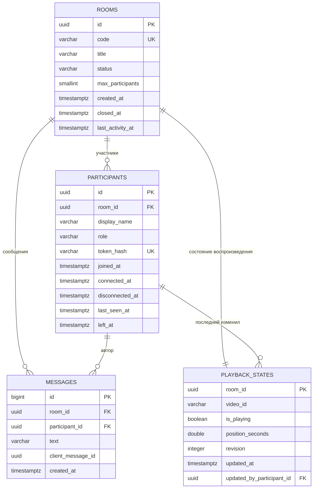

# База данных

СУБД — PostgreSQL 16. Доступ из backend — SQLAlchemy 2.x в async-режиме (`asyncpg`), миграции —
Alembic. Все timestamps хранятся в `TIMESTAMPTZ` и трактуются как UTC.

## 1. Принципы

- Комната, участник, сообщение и состояние playback — durable-данные в PostgreSQL.
- Владелец комнаты — не отдельная сущность, а участник с `role = 'owner'`. Отдельного
  `owner_token` в `rooms` нет.
- Позиция видео хранится как якорь (`position_seconds` + `updated_at`), а не обновляется каждую
  секунду.
- Presence (`is_online`), WebSocket-соединения и rate limit в БД не хранятся: это оперативная
  память backend.
- Токены доступа хранятся только в виде хешей.
- Удаление комнаты каскадно удаляет участников, playback и сообщения.

## 2. ER-диаграмма



Связи:

- `rooms 1 — N participants` — участники комнаты, включая владельца;
- `rooms 1 — 1 playback_states` — состояние воспроизведения; строка создаётся вместе с комнатой;
- `rooms 1 — N messages` — история чата;
- `participants 1 — N messages` — автор сообщения;
- `participants 1 — N playback_states` — кто последним изменил состояние (nullable).

## 3. Таблицы

### 3.1 `rooms`

| Колонка | Тип | Ограничения | Назначение |
| --- | --- | --- | --- |
| `id` | `UUID` | PK, default `gen_random_uuid()` | Внутренний идентификатор |
| `code` | `VARCHAR(12)` | NOT NULL, UNIQUE, CHECK `^[a-z0-9]{8,12}$` | Публичный код комнаты в ссылке |
| `title` | `VARCHAR(80)` | NULL | Необязательное название |
| `status` | `VARCHAR(16)` | NOT NULL, default `'active'`, CHECK `active/closed` | Статус комнаты |
| `max_participants` | `SMALLINT` | NOT NULL, default `10`, CHECK `2..10` | Лимит участников |
| `created_at` | `TIMESTAMPTZ` | NOT NULL, default `now()` | Создание |
| `closed_at` | `TIMESTAMPTZ` | NULL | Время закрытия |
| `last_activity_at` | `TIMESTAMPTZ` | NOT NULL, default `now()` | Для будущей очистки; обновляется с throttling |

```sql
CREATE TABLE rooms (
    id                UUID PRIMARY KEY DEFAULT gen_random_uuid(),
    code              VARCHAR(12)  NOT NULL,
    title             VARCHAR(80),
    status            VARCHAR(16)  NOT NULL DEFAULT 'active',
    max_participants  SMALLINT     NOT NULL DEFAULT 10,
    created_at        TIMESTAMPTZ  NOT NULL DEFAULT now(),
    closed_at         TIMESTAMPTZ,
    last_activity_at  TIMESTAMPTZ  NOT NULL DEFAULT now(),
    CONSTRAINT uq_rooms_code UNIQUE (code),
    CONSTRAINT ck_rooms_code_format CHECK (code ~ '^[a-z0-9]{8,12}$'),
    CONSTRAINT ck_rooms_status CHECK (status IN ('active', 'closed')),
    CONSTRAINT ck_rooms_max_participants CHECK (max_participants BETWEEN 2 AND 10),
    CONSTRAINT ck_rooms_closed_at CHECK ((status = 'closed') = (closed_at IS NOT NULL))
);

CREATE INDEX ix_rooms_status_last_activity ON rooms (status, last_activity_at);
```

`ck_rooms_closed_at` гарантирует согласованность: `closed_at` заполнен тогда и только тогда, когда
комната закрыта.

### 3.2 `participants`

| Колонка | Тип | Ограничения | Назначение |
| --- | --- | --- | --- |
| `id` | `UUID` | PK, default `gen_random_uuid()` | Идентификатор участника; он же `participant_id` в API |
| `room_id` | `UUID` | NOT NULL, FK → `rooms.id` ON DELETE CASCADE | Комната |
| `display_name` | `VARCHAR(32)` | NOT NULL, CHECK 1..32 после trim | Отображаемое имя |
| `role` | `VARCHAR(8)` | NOT NULL, default `'member'`, CHECK `owner/member` | Роль |
| `token_hash` | `VARCHAR(64)` | NOT NULL, UNIQUE, CHECK hex | SHA-256 access-токена (hex) |
| `joined_at` | `TIMESTAMPTZ` | NOT NULL, default `now()` | Вход в комнату |
| `connected_at` | `TIMESTAMPTZ` | NULL | Последнее подключение WS |
| `disconnected_at` | `TIMESTAMPTZ` | NULL | Последнее отключение WS |
| `last_seen_at` | `TIMESTAMPTZ` | NOT NULL, default `now()` | Активность (throttled) |
| `left_at` | `TIMESTAMPTZ` | NULL | Добровольный выход / удаление |

```sql
CREATE TABLE participants (
    id               UUID PRIMARY KEY DEFAULT gen_random_uuid(),
    room_id          UUID         NOT NULL REFERENCES rooms (id) ON DELETE CASCADE,
    display_name     VARCHAR(32)  NOT NULL,
    role             VARCHAR(8)   NOT NULL DEFAULT 'member',
    token_hash       VARCHAR(64)  NOT NULL,
    joined_at        TIMESTAMPTZ  NOT NULL DEFAULT now(),
    connected_at     TIMESTAMPTZ,
    disconnected_at  TIMESTAMPTZ,
    last_seen_at     TIMESTAMPTZ  NOT NULL DEFAULT now(),
    left_at          TIMESTAMPTZ,
    CONSTRAINT ck_participants_role CHECK (role IN ('owner', 'member')),
    CONSTRAINT ck_participants_display_name CHECK (char_length(btrim(display_name)) BETWEEN 1 AND 32),
    CONSTRAINT ck_participants_token_hash CHECK (token_hash ~ '^[0-9a-f]{64}$')
);

CREATE UNIQUE INDEX uq_participants_token_hash ON participants (token_hash);
CREATE UNIQUE INDEX uq_participants_room_display_name
    ON participants (room_id, lower(display_name))
    WHERE left_at IS NULL;
CREATE UNIQUE INDEX uq_participants_room_owner
    ON participants (room_id)
    WHERE role = 'owner';
CREATE INDEX ix_participants_room_id ON participants (room_id);
```

Ограничения и их смысл:

- `uq_participants_token_hash` — один токен = один участник;
- `uq_participants_room_display_name` — в активной комнате нет двух одинаковых имён
  (регистронезависимо), это защищает от визуальной подмены владельца;
- `uq_participants_room_owner` — у комнаты максимум один владелец; повторная вставка `owner`
  упадёт на уровне БД;
- `left_at IS NULL` в индексе имени позволяет вернуться в комнату с тем же именем после выхода.

> `is_online` не хранится. API вычисляет его из памяти `ConnectionManager`. `connected_at` и
> `disconnected_at` — аудит последнего подключения, а не источник истины для presence.

### 3.3 `playback_states`

| Колонка | Тип | Ограничения | Назначение |
| --- | --- | --- | --- |
| `room_id` | `UUID` | PK, FK → `rooms.id` ON DELETE CASCADE | Комната (1:1) |
| `video_id` | `VARCHAR(11)` | NULL, CHECK 11 символов YouTube | Текущее видео |
| `is_playing` | `BOOLEAN` | NOT NULL, default `false` | Играет ли видео |
| `position_seconds` | `DOUBLE PRECISION` | NOT NULL, default `0`, CHECK `0..86400` | Позиция на момент `updated_at` |
| `revision` | `INTEGER` | NOT NULL, default `0`, CHECK `>= 0` | Монотонный счётчик изменений |
| `updated_at` | `TIMESTAMPTZ` | NOT NULL, default `now()` | Время фиксации позиции |
| `updated_by_participant_id` | `UUID` | NULL, FK → `participants.id` ON DELETE SET NULL | Кто изменил |

```sql
CREATE TABLE playback_states (
    room_id                    UUID PRIMARY KEY REFERENCES rooms (id) ON DELETE CASCADE,
    video_id                   VARCHAR(11),
    is_playing                 BOOLEAN          NOT NULL DEFAULT false,
    position_seconds           DOUBLE PRECISION NOT NULL DEFAULT 0,
    revision                   INTEGER          NOT NULL DEFAULT 0,
    updated_at                 TIMESTAMPTZ      NOT NULL DEFAULT now(),
    updated_by_participant_id  UUID REFERENCES participants (id) ON DELETE SET NULL,
    CONSTRAINT ck_playback_video_id CHECK (video_id IS NULL OR video_id ~ '^[A-Za-z0-9_-]{11}$'),
    CONSTRAINT ck_playback_position CHECK (position_seconds >= 0 AND position_seconds <= 86400),
    CONSTRAINT ck_playback_revision CHECK (revision >= 0),
    CONSTRAINT ck_playback_without_video CHECK (
        video_id IS NOT NULL OR (is_playing = false AND position_seconds = 0)
    )
);

CREATE INDEX ix_playback_updated_by ON playback_states (updated_by_participant_id);
```

`ck_playback_without_video` не даёт «играть» комнате без видео. Позиция ограничена 24 часами —
защита от мусорных значений; YouTube сам ограничит воспроизведение длиной ролика.

### 3.4 `messages`

| Колонка | Тип | Ограничения | Назначение |
| --- | --- | --- | --- |
| `id` | `BIGINT` | PK, `GENERATED ALWAYS AS IDENTITY` | Порядок и курсор пагинации |
| `room_id` | `UUID` | NOT NULL, FK → `rooms.id` ON DELETE CASCADE | Комната |
| `participant_id` | `UUID` | NOT NULL, FK → `participants.id` ON DELETE CASCADE | Автор |
| `text` | `VARCHAR(500)` | NOT NULL, CHECK 1..500 после trim | Текст сообщения |
| `client_message_id` | `UUID` | NULL | Идемпотентность отправки |
| `created_at` | `TIMESTAMPTZ` | NOT NULL, default `now()` | Время отправки |

```sql
CREATE TABLE messages (
    id                 BIGINT GENERATED ALWAYS AS IDENTITY PRIMARY KEY,
    room_id            UUID          NOT NULL REFERENCES rooms (id) ON DELETE CASCADE,
    participant_id     UUID          NOT NULL REFERENCES participants (id) ON DELETE CASCADE,
    text               VARCHAR(500)  NOT NULL,
    client_message_id  UUID,
    created_at         TIMESTAMPTZ   NOT NULL DEFAULT now(),
    CONSTRAINT ck_messages_text CHECK (char_length(btrim(text)) BETWEEN 1 AND 500)
);

CREATE INDEX ix_messages_room_id_id ON messages (room_id, id DESC);
CREATE UNIQUE INDEX uq_messages_participant_client_id
    ON messages (participant_id, client_message_id)
    WHERE client_message_id IS NOT NULL;
```

`BIGINT IDENTITY` выбран вместо UUID, потому что сообщения листаются курсором `before_id` и
сортируются по порядку вставки. `client_message_id` позволяет клиенту безопасно повторить отправку:
повтор с тем же id не создаст дубль.

## 4. Индексы: зачем каждый

| Индекс | Запрос, который он ускоряет |
| --- | --- |
| `uq_rooms_code` | Вход по ссылке, `GET /rooms/{room_code}` |
| `ix_rooms_status_last_activity` | Будущая очистка неактивных комнат |
| `uq_participants_token_hash` | Авторизация по Bearer-токену |
| `ix_participants_room_id` | Список участников комнаты |
| `uq_participants_room_display_name` | Проверка занятости имени при join |
| `uq_participants_room_owner` | Гарантия единственного владельца |
| `ix_messages_room_id_id` | Последние 50 сообщений, пагинация `before_id` |
| `uq_messages_participant_client_id` | Идемпотентность `chat.send` |
| `ix_playback_updated_by` | Поиск комнат, где участник менял playback (диагностика) |

## 5. Что хранится только в памяти

| Данные | Причина | Что происходит при рестарте |
| --- | --- | --- |
| WebSocket-соединения | Не сериализуются | Клиенты переподключаются |
| `is_online` | Производное от соединений | Пересчитывается после reconnect |
| Grace-таймеры (15 с) | Эфемерны | Теряются, presence восстанавливается |
| Rate limit bucket'ы | Эфемерны | Сбрасываются (допустимо) |
| `jti` использованных WS-ticket'ов | Живут ≤ 60 с | Сбрасываются (допустимо) |
| Актуальная позиция видео | Вычисляется из якоря | Пересчитывается по `updated_at` |

## 6. Сценарии работы с БД

### 6.1 Создание комнаты

Одна транзакция: комната, владелец, пустое playback-состояние.

```sql
BEGIN;

INSERT INTO rooms (code, title, max_participants)
VALUES ('k7m2p9qx', 'Вечерний просмотр', 10)
RETURNING id, code, status, created_at;

INSERT INTO participants (room_id, display_name, role, token_hash)
VALUES (:room_id, 'Аня', 'owner', :sha256_hex)
RETURNING id, display_name, role, joined_at;

INSERT INTO playback_states (room_id)
VALUES (:room_id);

COMMIT;
```

Код комнаты генерируется в приложении; при `unique_violation` на `uq_rooms_code` — до 5 повторов
с новым кодом.

### 6.2 Вход участника с проверкой лимита

Блокировка строки комнаты исключает гонку, при которой 11-й участник проходит проверку
одновременно с 10-м.

```sql
BEGIN;

SELECT id, status, max_participants
FROM rooms
WHERE code = :code
FOR UPDATE;

-- приложение проверяет status = 'active'

SELECT count(*) AS active_count
FROM participants
WHERE room_id = :room_id AND left_at IS NULL;

-- если active_count >= max_participants → ROLLBACK, ошибка room_full

INSERT INTO participants (room_id, display_name, role, token_hash)
VALUES (:room_id, :display_name, 'member', :sha256_hex)
RETURNING id, display_name, role, joined_at;

COMMIT;
```

При нарушении `uq_participants_room_display_name` приложение возвращает `name_taken`.

### 6.3 Изменение playback

```sql
BEGIN;

SELECT video_id, is_playing, position_seconds, revision, updated_at
FROM playback_states
WHERE room_id = :room_id
FOR UPDATE;

-- валидация и расчёт новой позиции в сервисе

UPDATE playback_states
SET position_seconds          = :position,
    is_playing                = :is_playing,
    revision                  = revision + 1,
    updated_at                = now(),
    updated_by_participant_id = :participant_id
WHERE room_id = :room_id
RETURNING video_id, is_playing, position_seconds, revision, updated_at;

COMMIT;
```

`revision` увеличивается на 1 при каждом принятом изменении; `updated_at` всегда серверное.

### 6.4 Чат: отправка и история

```sql
INSERT INTO messages (room_id, participant_id, text, client_message_id)
VALUES (:room_id, :participant_id, :text, :client_message_id)
ON CONFLICT (participant_id, client_message_id)
    WHERE client_message_id IS NOT NULL
DO NOTHING
RETURNING id, created_at;
```

Если `ON CONFLICT` не вернул строку — сообщение уже сохранено, сервер находит его по
`(participant_id, client_message_id)` и не создаёт дубль.

История (страница старее `before_id`):

```sql
SELECT id, participant_id, text, created_at
FROM messages
WHERE room_id = :room_id
  AND (:before_id IS NULL OR id < :before_id)
ORDER BY id DESC
LIMIT :limit + 1;
```

Приложение отдаёт строки в возрастающем порядке и вычисляет `has_more` по наличию лишней строки.

### 6.5 Выход и отключение

```sql
-- добровольный выход
UPDATE participants
SET left_at = now(), disconnected_at = COALESCE(disconnected_at, now())
WHERE id = :participant_id AND left_at IS NULL;

-- отключение после grace-периода (вызывает presence-модуль)
UPDATE participants
SET disconnected_at = now()
WHERE id = :participant_id;
```

`is_online` при этом не меняется в БД: его считает память.

### 6.6 Закрытие комнаты

```sql
UPDATE rooms
SET status = 'closed', closed_at = now(), last_activity_at = now()
WHERE code = :code AND status = 'active'
RETURNING id, closed_at;
```

Если строка не обновлена — комната уже закрыта, операция идемпотентна.

## 7. Миграции и эволюция схемы

- Alembic — единственный способ менять схему. Ручной SQL в БД разработчика не считается
  изменением схемы.
- Одна миграция = одно логическое изменение. В PR не должно быть нескольких независимых миграций.
- Миграции пишет Backend-разработчик; Realtime предлагает изменения для `playback_states` через
  PR/issue и не создаёт миграции самостоятельно.
- Перед merge: `alembic upgrade head` на чистой БД и `alembic downgrade -1` (если downgrade
  реализуем). Все миграции обязаны иметь рабочий `downgrade`.
- В `alembic/env.py` импортируются все `models.py`; при добавлении модуля импорт обязателен.
- Имена ограничений и индексов задаются явно (как в DDL выше), чтобы autogenerate не создавал
  случайные имена.
- Контрактные изменения (`NOT NULL`, удаление колонки, смена типа) согласуются с
  [TEAM_WORKFLOW.md](./TEAM_WORKFLOW.md#5-изменение-общих-контрактов) и фиксируются в
  [CHANGELOG_DEV.md](./CHANGELOG_DEV.md).

## 8. Очистка данных (вне MVP)

Закрытые комнаты и их содержимое можно удалять фоновой задачей (например, старше 7 дней). Для
этого уже есть `status`, `closed_at` и `ix_rooms_status_last_activity`. В MVP задача не
реализуется; удаление выполняется вручную при необходимости.
