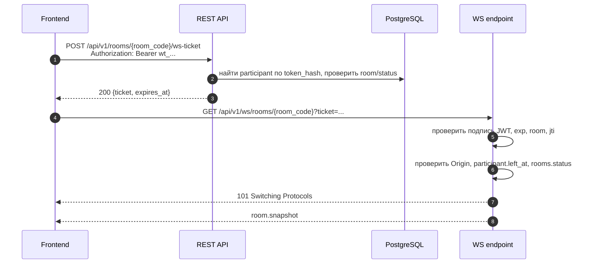
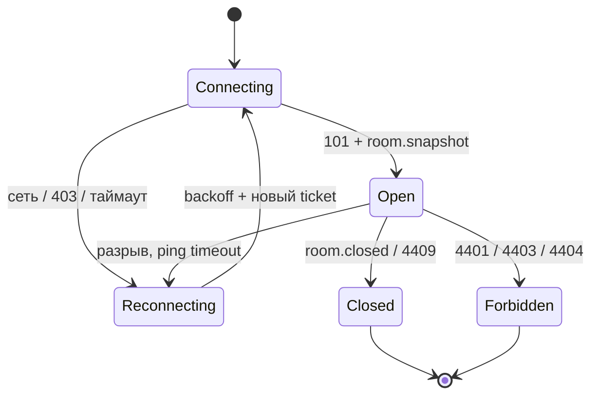
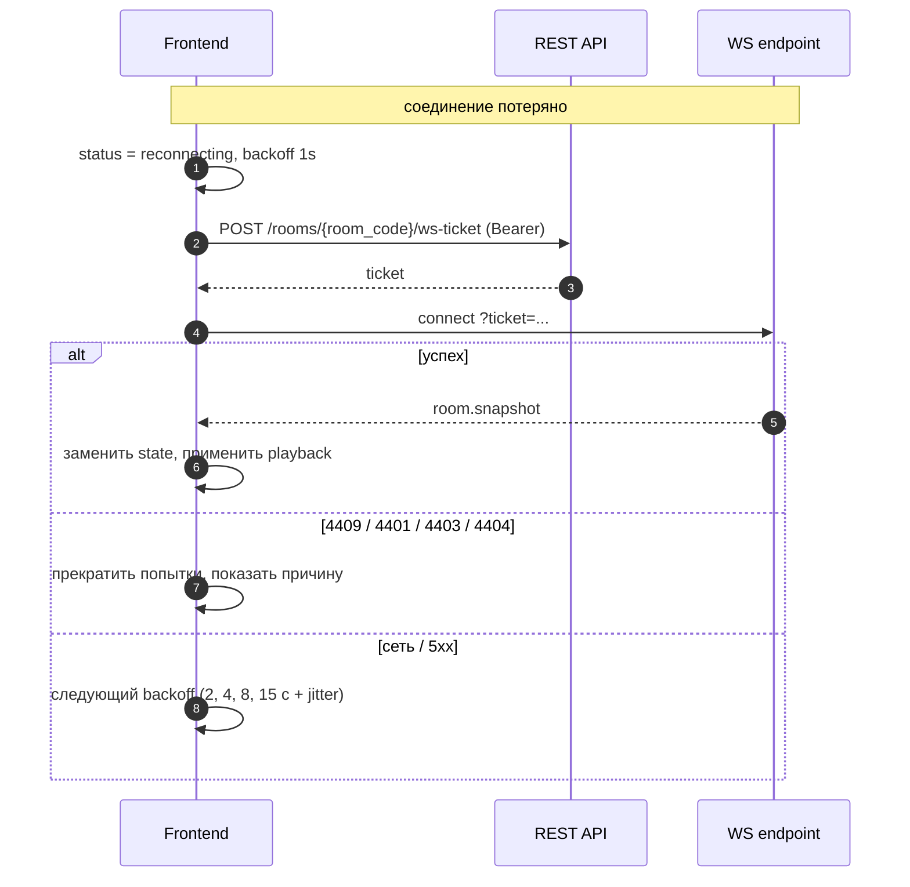

# WebSocket и синхронизация

WebSocket отвечает за всё, что происходит внутри открытой комнаты: воспроизведение, смену видео,
чат, присутствие и закрытие. REST (см. [API.md](./API.md)) — только жизненный цикл: создание,
вход, история, ticket, выход, закрытие.

Backend — единственный источник истины для playback. Клиенты не договариваются между собой
напрямую: любое действие проходит валидацию на сервере, получает новую `revision` и рассылается
всем участникам.

## 1. Подключение и авторизация

**URL**

```text
ws://localhost:8000/api/v1/ws/rooms/{room_code}?ticket={ws_ticket}
wss://watch-party.example/api/v1/ws/rooms/{room_code}?ticket={ws_ticket}
```

Постоянный `access_token` в URL **не передаётся**. Вместо него клиент получает одноразовый
краткоживущий ticket через REST.



Свойства ticket:

- JWT HS256, подпись `APP_SECRET_KEY`;
- claims: `sub` (participant_id), `room` (room_code), `jti`, `iat`, `exp`;
- TTL 60 секунд, одноразовый (использованный `jti` хранится в памяти до истечения TTL);
- привязан к комнате и участнику; чужую комнату открыть нельзя;
- ошибка проверки до `accept` возвращает HTTP `403` на handshake (браузер увидит ошибку
  соединения), после `accept` — закрытие с соответствующим кодом.

`Origin` проверяется по `CORS_ORIGINS`: это защита от cross-site WebSocket hijacking.

## 2. Жизненный цикл соединения



Порядок действий сервера после `accept`:

1. зарегистрировать сокет в `ConnectionManager`;
2. отправить новому соединению `room.snapshot`;
3. если участник был offline — обновить `connected_at` и разослать `participant.joined`
   остальным соединениям комнаты;
4. читать входящие события до закрытия.

Снимок отправляется **до** любых broadcast'ов, чтобы клиент не применял события к пустому
состоянию.

## 3. Конверт сообщений

Все сообщения — JSON-объекты.

**Server → Client**

```json
{
  "type": "playback.state",
  "event_id": "b3f1c2d4-5e6a-4b7c-8d9e-0f1a2b3c4d5e",
  "room_code": "k7m2p9qx",
  "server_time": "2026-11-24T18:07:12.480Z",
  "request_id": null,
  "payload": {}
}
```

| Поле | Обяз. | Описание |
| --- | --- | --- |
| `type` | да | Имя события из каталога |
| `event_id` | да | UUID события; для логов и диагностики |
| `room_code` | да | Код комнаты |
| `server_time` | да | Серверное время отправки, ISO 8601 UTC |
| `request_id` | нет | Эхо `request_id` клиента, если событие — ответ |
| `payload` | да | Тело события, объект |

**Client → Server**

```json
{
  "type": "playback.command",
  "request_id": "a1b2c3d4-0000-4000-8000-123456789abc",
  "payload": { "action": "seek", "position_seconds": 120.0 }
}
```

| Поле | Обяз. | Описание |
| --- | --- | --- |
| `type` | да | Имя события |
| `request_id` | нет | UUID запроса; сервер вернёт его в ответе или ошибке |
| `payload` | да | Тело события |

`room_code` в клиентских сообщениях не передаётся: соединение уже привязано к комнате.

## 4. Каталог событий

| Событие | Направление | Назначение |
| --- | --- | --- |
| `room.snapshot` | S → C | Полный срез комнаты при входе и по запросу |
| `room.sync.request` | C → S | Запросить полный срез (после reconnect, при подозрении на рассинхрон) |
| `playback.command` | C → S | Play / pause / seek |
| `playback.state` | S → C | Новое авторитетное состояние playback |
| `playback.sync.request` | C → S | Запросить только playback-состояние |
| `video.change` | C → S | Сменить видео (только `owner`) |
| `chat.send` | C → S | Отправить сообщение |
| `chat.message` | S → C | Новое сообщение в комнате |
| `participant.joined` | S → C | Участник стал онлайн |
| `participant.left` | S → C | Участник ушёл или истёк grace-период |
| `room.closed` | S → C | Комната закрыта владельцем |
| `ping` | C → S | Проверка задержки и живости |
| `pong` | S → C | Ответ на `ping` |
| `error` | S → C | Ошибка обработки события |

## 5. Контракты событий

### 5.1 `room.snapshot` (S → C)

Отправляется сразу после `accept` и в ответ на `room.sync.request`. Заменяет клиентское состояние
целиком.

```json
{
  "type": "room.snapshot",
  "event_id": "5a4b3c2d-1e0f-4a9b-8c7d-6e5f4a3b2c1d",
  "room_code": "k7m2p9qx",
  "server_time": "2026-11-24T18:07:00.000Z",
  "request_id": null,
  "payload": {
    "room": {
      "room_code": "k7m2p9qx",
      "title": "Вечерний просмотр",
      "status": "active",
      "max_participants": 10,
      "created_at": "2026-11-24T18:00:00.000Z",
      "closed_at": null
    },
    "playback": {
      "video_id": "dQw4w9WgXcQ",
      "video_url": "https://www.youtube.com/watch?v=dQw4w9WgXcQ",
      "is_playing": true,
      "position_seconds": 42.5,
      "updated_at": "2026-11-24T18:06:58.000Z",
      "revision": 17,
      "updated_by_participant_id": "0f8fad5b-d9cb-469f-a165-70867728950e"
    },
    "participants": [
      {
        "participant_id": "0f8fad5b-d9cb-469f-a165-70867728950e",
        "display_name": "Аня",
        "role": "owner",
        "is_online": true,
        "joined_at": "2026-11-24T18:00:00.000Z"
      },
      {
        "participant_id": "7c9e6679-7425-40de-944b-e07fc1f90ae7",
        "display_name": "Борис",
        "role": "member",
        "is_online": true,
        "joined_at": "2026-11-24T18:02:10.000Z"
      }
    ],
    "messages": [
      {
        "message_id": 126,
        "room_code": "k7m2p9qx",
        "participant_id": "0f8fad5b-d9cb-469f-a165-70867728950e",
        "display_name": "Аня",
        "text": "Начинаем?",
        "created_at": "2026-11-24T18:05:30.000Z",
        "client_message_id": null
      }
    ],
    "you": {
      "participant_id": "7c9e6679-7425-40de-944b-e07fc1f90ae7",
      "role": "member"
    }
  }
}
```

`messages` — последние 50 сообщений в возрастающем порядке. Более старые — через REST.

### 5.2 `room.sync.request` (C → S)

```json
{ "type": "room.sync.request", "request_id": "uuid", "payload": {} }
```

Ответ — `room.snapshot` с тем же `request_id`. Лимит: 1 раз в 5 секунд.

### 5.3 `playback.command` (C → S)

```json
{
  "type": "playback.command",
  "request_id": "a1b2c3d4-0000-4000-8000-123456789abc",
  "payload": {
    "action": "seek",
    "position_seconds": 120.0
  }
}
```

| Поле | Тип | Обяз. | Описание |
| --- | --- | --- | --- |
| `action` | `"play" \| "pause" \| "seek"` | да | Действие |
| `position_seconds` | number | да | Позиция плеера клиента в момент действия, `0..86400` |

Правила:

- `play`/`pause` используют `position_seconds` как позицию, с которой продолжать/встать на паузу;
  сервер отклоняет команду с `stale_position`, если расхождение с расчётной серверной позицией
  больше 3 секунд;
- `seek` принимает любую позицию из диапазона и не меняет `is_playing`;
- команда при `video_id = null` отклоняется `video_not_set`;
- если состояние не меняется (тот же `is_playing`, позиция отличается меньше чем на 0.25 с),
  broadcast не выполняется — только отправителю уходит `playback.state` с текущим состоянием;
- ответственного ack нет: подтверждение — `playback.state`, разосланный всем.

### 5.4 `playback.state` (S → C)

```json
{
  "type": "playback.state",
  "event_id": "c7d8e9f0-1a2b-4c3d-9e8f-7a6b5c4d3e2f",
  "room_code": "k7m2p9qx",
  "server_time": "2026-11-24T18:07:12.480Z",
  "request_id": null,
  "payload": {
    "reason": "command",
    "playback": {
      "video_id": "dQw4w9WgXcQ",
      "video_url": "https://www.youtube.com/watch?v=dQw4w9WgXcQ",
      "is_playing": true,
      "position_seconds": 120.0,
      "updated_at": "2026-11-24T18:07:12.470Z",
      "revision": 18,
      "updated_by_participant_id": "7c9e6679-7425-40de-944b-e07fc1f90ae7"
    }
  }
}
```

`reason`:

| Значение | Когда |
| --- | --- |
| `command` | Результат `playback.command` (broadcast или unicast при no-op) |
| `video_change` | Владелец сменил видео |
| `sync_request` | Ответ на `playback.sync.request` (unicast) |

Клиент обязан игнорировать состояние с `revision` меньше локального.

### 5.5 `playback.sync.request` (C → S)

```json
{ "type": "playback.sync.request", "request_id": "uuid", "payload": {} }
```

Ответ — unicast `playback.state` c `reason = "sync_request"` и текущей `revision`. Лимит: 1 раз в
5 секунд.

### 5.6 `video.change` (C → S)

Только `owner`.

```json
{
  "type": "video.change",
  "request_id": "uuid",
  "payload": { "video_url": "https://youtu.be/dQw4w9WgXcQ" }
}
```

Сервер валидирует ссылку (см. [API.md, раздел 6](./API.md#6-валидация-youtube-ссылок)),
устанавливает `video_id`, `is_playing = false`, `position_seconds = 0`, `revision + 1` и рассылает
`playback.state` с `reason = "video_change"` всем, включая владельца.

Ошибки: `forbidden` (не владелец), `validation_error` (ссылка), `room_closed`.

Лимит: 1 смена в 2 секунды на участника.

### 5.7 `chat.send` (C → S)

```json
{
  "type": "chat.send",
  "request_id": "uuid",
  "payload": {
    "text": "Начинаем?",
    "client_message_id": "c56a4180-65aa-42ec-a945-5fd21dec0538"
  }
}
```

| Поле | Тип | Обяз. | Описание |
| --- | --- | --- | --- |
| `text` | string | да | trim 1..500, без control-символов кроме `\n` |
| `client_message_id` | UUID | да | Генерируется клиентом; идемпотентность |

Сервер сохраняет сообщение и рассылает `chat.message` всем, включая отправителя. Повтор с тем же
`client_message_id` не создаёт дубль: сервер повторно рассылает существующее сообщение.
Лимит: token bucket 1 сообщение/с, burst 5.

Ошибки: `validation_error`, `rate_limited`, `room_closed`.

### 5.8 `chat.message` (S → C)

```json
{
  "type": "chat.message",
  "event_id": "d1e2f3a4-5b6c-4d7e-8f90-1a2b3c4d5e6f",
  "room_code": "k7m2p9qx",
  "server_time": "2026-11-24T18:08:00.120Z",
  "request_id": null,
  "payload": {
    "message": {
      "message_id": 128,
      "room_code": "k7m2p9qx",
      "participant_id": "7c9e6679-7425-40de-944b-e07fc1f90ae7",
      "display_name": "Борис",
      "text": "Начинаем?",
      "created_at": "2026-11-24T18:08:00.100Z",
      "client_message_id": "c56a4180-65aa-42ec-a945-5fd21dec0538"
    }
  }
}
```

### 5.9 `participant.joined` (S → C)

Отправляется, когда участник перешёл из offline в online (первое соединение), а также при
переподключении после grace-периода. Остальным соединениям комнаты; новому соединению уже пришёл
`room.snapshot`.

```json
{
  "type": "participant.joined",
  "event_id": "e2f3a4b5-6c7d-4e8f-9a0b-1c2d3e4f5a6b",
  "room_code": "k7m2p9qx",
  "server_time": "2026-11-24T18:09:00.000Z",
  "request_id": null,
  "payload": {
    "participant": {
      "participant_id": "c56a4180-65aa-42ec-a945-5fd21dec0538",
      "display_name": "Вера",
      "role": "member",
      "is_online": true,
      "joined_at": "2026-11-24T18:08:55.000Z"
    },
    "participants": [
      { "...полный список активных участников..." }
    ]
  }
}
```

`participants` — полный актуальный список (≤ 10), поэтому клиент может просто заменить массив, а
не мержить.

### 5.10 `participant.left` (S → C)

Отправляется после выхода (`leave`) или истечения 15-секундного grace-периода.

```json
{
  "type": "participant.left",
  "event_id": "f3a4b5c6-7d8e-4f90-8a1b-2c3d4e5f6a7b",
  "room_code": "k7m2p9qx",
  "server_time": "2026-11-24T18:10:15.000Z",
  "request_id": null,
  "payload": {
    "participant_id": "c56a4180-65aa-42ec-a945-5fd21dec0538",
    "participants": [
      { "...полный список активных участников..." }
    ]
  }
}
```

### 5.11 `room.closed` (S → C)

```json
{
  "type": "room.closed",
  "event_id": "a4b5c6d7-8e9f-4a0b-9c1d-2e3f4a5b6c7d",
  "room_code": "k7m2p9qx",
  "server_time": "2026-11-24T18:12:00.000Z",
  "request_id": null,
  "payload": {
    "room_code": "k7m2p9qx",
    "closed_at": "2026-11-24T18:12:00.000Z",
    "closed_by_participant_id": "0f8fad5b-d9cb-469f-a165-70867728950e"
  }
}
```

После broadcast сервер закрывает все соединения кодом `4409`. Клиент показывает экран «Комната
закрыта» и прекращает переподключения.

### 5.12 `ping` / `pong`

```json
{ "type": "ping", "request_id": "uuid", "payload": { "client_time": "2026-11-24T18:11:00.000Z" } }
```

```json
{
  "type": "pong",
  "event_id": "b5c6d7e8-9f0a-4b1c-8d2e-3f4a5b6c7d8e",
  "room_code": "k7m2p9qx",
  "server_time": "2026-11-24T18:11:00.045Z",
  "request_id": "uuid",
  "payload": { "client_time": "2026-11-24T18:11:00.000Z" }
}
```

`ping` нужен клиенту для оценки задержки и диагностики. Обнаружение мёртвых соединений делает
сервер через protocol-level ping WebSocket (раздел 8). Лимит app-level `ping`: 1 раз в 5 секунд.

### 5.13 `error` (S → C)

```json
{
  "type": "error",
  "event_id": "c6d7e8f9-0a1b-4c2d-9e3f-4a5b6c7d8e9f",
  "room_code": "k7m2p9qx",
  "server_time": "2026-11-24T18:12:30.000Z",
  "request_id": "a1b2c3d4-0000-4000-8000-123456789abc",
  "payload": {
    "code": "stale_position",
    "message": "Client position is too far from the current playback position",
    "details": { "server_position_seconds": 118.4 }
  }
}
```

| `code` | Причина |
| --- | --- |
| `validation_error` | Неверный JSON, payload, длина текста, формат UUID |
| `unsupported_event` | Неизвестный `type` |
| `forbidden` | Действие требует `owner` |
| `video_not_set` | Playback-команда без выбранного видео |
| `stale_position` | `play`/`pause` с позицией, отставшей от серверной > 3 с |
| `rate_limited` | Превышен лимит события |
| `room_closed` | Комната закрыта |
| `internal_error` | Ошибка БД/сервера; детали в логах |

Ошибка не закрывает соединение, кроме `rate_limited` при систематическом спаме и нарушений
протокола (раздел 10).

## 6. Обработка команд на сервере

1. Проверить `type` и схему payload (Pydantic); UUID `request_id`/`client_message_id` валиден.
2. Проверить rate limit по `(participant_id, event_type)`.
3. Открыть сессию БД на одно событие (без долгих транзакций).
4. Для playback/video — взять `asyncio.Lock` комнаты, затем `SELECT ... FOR UPDATE`
   `playback_states`. Это сериализует команды и гарантирует порядок `revision`.
5. Выполнить бизнес-операцию сервиса.
6. `COMMIT`.
7. Разослать событие через `ConnectionManager` уже после commit.
8. Обновить `rooms.last_activity_at`, но не чаще раза в 60 секунд на комнату.

Если commit не удался — broadcast не выполняется, клиент получает `error`. Отправка каждому
сокету оборачивается таймаутом 5 секунд; «залипший» сокет закрывается, остальные получают событие.

## 7. Алгоритм синхронизации

### 7.1 Сервер

Хранится якорь `(position_seconds, is_playing, updated_at, revision)`. Сервер не пишет позицию
каждую секунду.

```text
current_position(server_now) =
    is_playing
        ? position_seconds + max(0, server_now − updated_at)
        : position_seconds
```

- каждая принятая команда: `updated_at = now()`, `revision += 1`;
- `playback.state` содержит `server_time` — время отправки;
- `room.snapshot` содержит то же состояние и `server_time`;
- периодического broadcast нет;
- `playback.sync.request` возвращает состояние только запросившему.

### 7.2 Клиент после получения `playback.state` / `room.snapshot`

```text
if (state.revision < local.revision) ignore
elapsed   = state.is_playing ? max(0, (server_time − state.updated_at) / 1000) : 0
target    = state.position_seconds + elapsed
```

Далее:

1. если `video_id` изменился — `player.load(video_id, target)` и дождаться `ready`;
2. если `player.getStatus()` не соответствует `is_playing` — `player.play()` / `player.pause()`;
3. если `|player.getCurrentTime() − target| > 1.0` — `player.seekTo(target)`;
4. запомнить якорь `{ expected: target, at: performance.now(), isPlaying }`;
5. все программные вызовы выполнять с флагом `isApplyingRemote`, чтобы события плеера не ушли
   обратно на сервер.

### 7.3 Локальный watchdog (раз в 5 секунд)

```text
expected = anchor.expected + (anchor.isPlaying ? (performance.now() − anchor.at) / 1000 : 0)
drift    = player.getCurrentTime() − expected
```

| Условие | Действие |
| --- | --- |
| `|drift| > 1.5` | `player.seekTo(expected)` |
| `|drift| > 3.0` два замера подряд | `playback.sync.request` (не чаще 1 раза в 5 с) |
| плеер на паузе, а `anchor.isPlaying = true`, статус не `buffering` | один `player.play()`, затем проверка |
| плеер играет, а `anchor.isPlaying = false` | `player.pause()` |

Watchdog не отправляет команды на сервер при обычной буферизации: статус `buffering` и `unstarted`
исключаются из сравнения. Это лечит накопленный дрейф без «дёргания» комнаты.

### 7.4 Действия пользователя → команды

- `onStateChange = PLAYING` и это не `isApplyingRemote` → `playback.command(play, currentTime)`;
- `onStateChange = PAUSED` и это не `isApplyingRemote` → `playback.command(pause, currentTime)`;
- `onStateChange = ENDED` → `playback.command(pause, duration)`;
- перемотка пользователем: локальный детектор раз в 500 мс сравнивает фактическую позицию с
  ожидаемой; скачок > 2 с при статусе `playing`/`paused` и не `isApplyingRemote` →
  `playback.command(seek, currentTime)`;
- `BUFFERING` игнорируется.

Autoplay: браузер может запретить `play()` без жеста. В этом случае клиент не отправляет команду,
показывает оверлей «Нажмите, чтобы синхронизироваться» и после клика применяет последнее состояние.

### 7.5 Почему не «сервер шлёт позицию каждую секунду»

- 10 участников × 1 событие/с = постоянный трафик и нагрузка без изменения состояния;
- сетевой jitter всё равно требует локальной коррекции;
- timestamped state + локальный watchdog дают ту же точность при событиях «по требованию»;
- при потере события клиент восстановится по следующему событию, watchdog'у или snapshot.

## 8. Presence и отключение участников

- `ConnectionManager` хранит `room_code → participant_id → set[WebSocket]`.
- `is_online = true`, пока есть хотя бы одно соединение участника.
- Переход offline → online: `connected_at = now()`, broadcast `participant.joined`.
- Закрытие последнего соединения: запускается grace-таймер 15 секунд.
  - reconnect в течение grace → таймер отменяется, `participant.left` не отправляется;
  - таймер истёк → `disconnected_at = now()`, broadcast `participant.left`.
- Явный `leave` или выход из комнаты: немедленный offline без grace, broadcast `participant.left`.
  Событие инициирует REST-обработчик через порт `RoomEventPublisher` (см.
  [ARCHITECTURE.md](./ARCHITECTURE.md#4-компоненты-backend)).
- Закрытие комнаты: `room.closed`, затем закрытие сокетов; отдельные `participant.left` не нужны.
- Сервер каждые 25 секунд отправляет protocol-level ping; нет pong за 10 секунд → сокет
  закрывается, запускается grace.
- `last_seen_at` обновляется не чаще раза в 30 секунд на участника.

Участник, который ни разу не подключился, остаётся в списке с `is_online = false`, занимает место
до `leave` или закрытия комнаты.

## 9. Переподключение



Правила клиента:

- при `document.visibilitychange` → `visible` и статусе `reconnecting` — попытка сразу, без
  ожидания таймера;
- при `offline` — пауза попыток до события `online`;
- после успешного reconnect `room.snapshot` заменяет participants, messages и playback;
- `revision` из snapshot может быть больше локального — применяется всегда;
- при `room.closed` или `4409` реконнект не выполняется;
- при `invalid_token`/`forbidden` клиент предлагает войти заново.

## 10. Ошибки и коды закрытия

До `accept` ошибки авторизации возвращаются как HTTP `403` на handshake.

После `accept`:

| Код | Имя | Причина |
| --- | --- | --- |
| `1000` | normal | Нормальное закрытие клиентом |
| `1001` | going away | Страница закрывается / сервер останавливается |
| `1008` | policy violation | Систематическое нарушение протокола (битый JSON, спам) |
| `1009` | message too big | Сообщение больше 4 КБ |
| `1012` | service restart | Плановый рестарт backend |
| `4401` | invalid_ticket | Сессия потеряла валидность (участник удалён/токен отозван) |
| `4403` | forbidden | Нет доступа к комнате |
| `4404` | room_not_found | Комната исчезла |
| `4409` | room_closed | Комната закрыта |
| `4429` | rate_limited | Систематическое превышение лимитов |

Правила:

- битый JSON / неизвестный `type` → `error`, соединение остаётся;
- 5 ошибок протокола за 10 секунд → закрытие `1008`;
- `room.closed` всегда отправляется перед `4409`;
- при рестарте сервер рассылает `1001`/`1012`, клиенты переподключаются.

## 11. Клиентская реализация

Граница между UI (разработчик №1) и realtime (разработчик №3) — два интерфейса.

```ts
// frontend/src/player/types.ts — реализует разработчик №1
export type PlayerStatus =
  | 'unstarted'
  | 'playing'
  | 'paused'
  | 'buffering'
  | 'ended';

export interface PlayerAdapter {
  load(videoId: string, startSeconds: number): void;
  play(): void;
  pause(): void;
  seekTo(seconds: number): void;
  getCurrentTime(): number;
  getDuration(): number;
  getStatus(): PlayerStatus;
  isReady(): boolean;
  subscribe(listener: (event: PlayerEvent) => void): () => void;
}

export type PlayerEvent =
  | { type: 'ready' }
  | { type: 'status_changed'; status: PlayerStatus }
  | { type: 'error'; code: number };
```

```ts
// frontend/src/realtime/useRoomRealtime.ts — реализует разработчик №3
export interface UseRoomRealtimeOptions {
  roomCode: string;
  wsBaseUrl: string;
  getTicket: () => Promise<{ ticket: string }>; // вызов REST, предоставляет №1
  player: PlayerAdapter | null;
}

export interface RoomRealtime {
  status: 'connecting' | 'open' | 'reconnecting' | 'closed' | 'error';
  playback: PlaybackState | null;
  participants: Participant[];
  messages: Message[];
  you: { participant_id: string; role: 'owner' | 'member' } | null;
  error: WsErrorPayload | null;
  sendPlaybackCommand(action: 'play' | 'pause' | 'seek', positionSeconds: number): void;
  requestSync(): void;
  sendChatMessage(text: string): string; // возвращает client_message_id
  changeVideo(videoUrl: string): void;
}
```

Требования к реализации:

- типы протокола — `realtime/protocol.ts`, поля `snake_case`, без переименования;
- `getTicket` не кешируется: ticket одноразовый;
- сообщения чата дедуплицируются по `message_id` и `client_message_id`;
- при `room.snapshot` массивы заменяются, а не мержатся;
- ошибки UI отдаются через `error`, а не выбрасываются из хука;
- всё сетевое — в `realtime/`, компоненты не открывают WebSocket сами.

## 12. Лимиты WebSocket

| Событие | Лимит |
| --- | --- |
| `chat.send` | 1/с, burst 5 |
| `playback.command` | 5/с, burst 10 |
| `sync.request` (оба вида) | 1/5 с |
| `video.change` | 1/2 с |
| `ping` | 1/5 с |
| Размер сообщения | 4 КБ |
| Соединений на участника | 3 (вкладки) |
| Соединений на комнату | 30 |
| Участников в комнате | 10 (проверяется при join) |

Лимиты хранятся в памяти и действуют в пределах одного процесса (см.
[ARCHITECTURE.md](./ARCHITECTURE.md#9-отказоустойчивость-и-ограничения)).

## 13. Тестирование

Обязательные сценарии для realtime-разработчика перечислены в
[TESTING.md](./TESTING.md#5-тестирование-websocket-и-синхронизации): две вкладки и Play/Pause/Seek,
новый участник получает актуальную позицию, owner-only для смены видео, reconnect без потери
состояния, grace-период presence, закрытие комнаты, rate limit.
